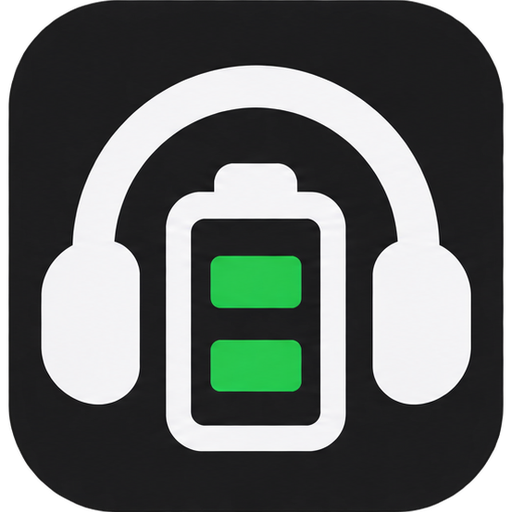
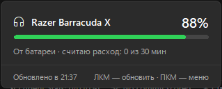
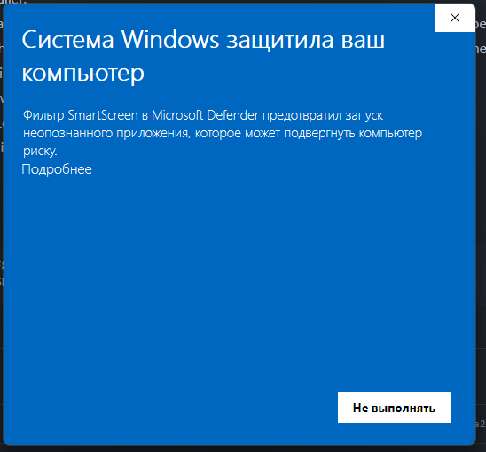
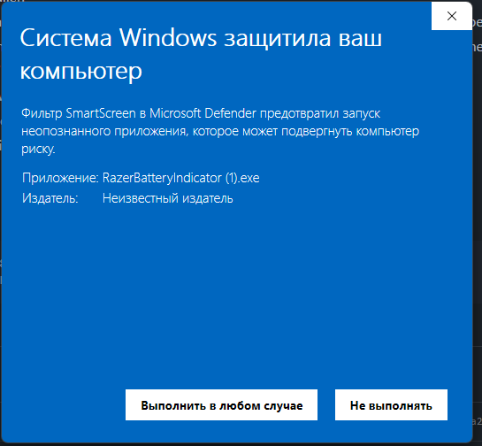

# razer-battery-tray

Shows the battery level of wireless Razer headsets, mice and keyboards on the Windows taskbar, next to the clock. Razer Synapse is not needed.

I wrote it because Synapse 4 doesn't know my Barracuda X 2.4 at all (its log says `supported type: unknown`), and Windows only reports battery for Bluetooth devices. The program asks the USB dongle directly.

**[Download RazerBatteryIndicator.exe](../../releases/latest)** (Windows 10/11)

On the taskbar, next to the tray:


Hovering over it opens a card:



## Установка

1. Откройте страницу [последней версии](../../releases/latest) и скачайте файл `RazerBatteryIndicator.exe`. Если браузер не даёт скачать exe, возьмите `RazerBatteryIndicator.zip` и распакуйте его.
2. Запустите его двойным щелчком. Windows, скорее всего, покажет синее окно. Это нормально, ниже объяснено почему. Нажмите «Подробнее»:

   

   Затем «Выполнить в любом случае»:

   
3. Всё. Программа сама установится: появятся ярлыки на рабочем столе и в меню «Пуск», а справа внизу, рядом с часами, заряд ваших устройств. Она будет запускаться вместе с Windows. Если это не нужно, нажмите на процент правой кнопкой и снимите галочку «Запускать с Windows». Скачанный файл после этого можно удалить.

Права администратора, Python и Synapse не нужны.

### Почему Windows или антивирус ругаются

Windows показывает это окно для любой программы, у которой нет цифровой подписи. Подпись разработчик покупает у специальных компаний: сертификат стоит примерно 300 долларов в год, и его нужно продлевать. Платить столько за бесплатную программу я не буду, поэтому подписи нет.

Слова «неизвестный издатель» значат только одно: Windows не знает, кто сделал файл. Она не проверяла его на вирусы и ничего плохого в нём не нашла. То же окно появляется у многих небольших бесплатных программ с GitHub. Когда файл скачает достаточно людей, SmartScreen обычно перестаёт его показывать.

Что ещё может встретиться:
- Браузер может написать, что файл «обычно не скачивают» или что он «может быть опасен». Выберите «Сохранить» или «Всё равно сохранить». Если exe не скачивается совсем, возьмите zip.
- Некоторые антивирусы ошибочно помечают программы, собранные PyInstaller, как подозрительные. Это известная ложная тревога.

Как убедиться, что файл настоящий: весь код открыт и лежит в этом репозитории (один файл `razer_battery.py`). У каждого релиза указана контрольная сумма SHA-256; проверить свой файл можно командой `certutil -hashfile RazerBatteryIndicator.exe SHA256` и сравнить с релизом. Программа не трогает ничего, кроме своей папки, ярлыков и автозапуска, и в интернет ходит только к GitHub за обновлениями.

Удалить программу можно как любую другую: «Параметры» → «Приложения» → «Установленные приложения» → Razer Battery Tray → «Удалить». Вместе с ней удаляются ярлыки, автозапуск и настройки.

## What you get

A small entry per device left of the tray icons: a headset, mouse or keyboard icon and the percentage. The background is transparent, so it sits on whatever taskbar you have (dark, light, accent colour, acrylic, TranslucentTB). The number turns yellow below 35% and red below 20%, and a lightning icon blinks while the device charges.

Hover over it and a card opens with a bar per device, the charging state and an estimate of how long the battery will last. The estimate is learned from how fast your own device actually drains, so the first one appears after about half an hour on battery. After that it is remembered.

When a device goes to sleep or is switched off, its last level stays on the taskbar, dimmed, and the card says when it was read.

A warning pops up at 20% and again at 10%, and once more when a device finishes charging. If a game or video is fullscreen at that moment, the warning waits until you leave it. The widget itself hides during fullscreen apps and never takes focus away from them.

Left click refreshes. Right click opens the menu: refresh, taskbar or "notch" mode (a small black pill at the top of the screen), start with Windows, exit.

It uses about 20 MB of RAM and close to zero CPU. Every battery query wakes the headset's radio, so while a device runs on battery it is asked only every 20 minutes, which leaves the headset free to switch itself off when idle. Hovering over the widget fetches fresh numbers right away, and so does waking the PC from sleep. While charging it checks every 5 minutes, and a device that's off is looked for once a minute (that only talks to the dongle).

## Install

1. Download `RazerBatteryIndicator.exe` from the [latest release](../../releases/latest). If your browser blocks exe downloads, take `RazerBatteryIndicator.zip` and unpack it.
2. Double-click it. Windows SmartScreen will most likely say "Windows protected your PC": click "More info", then "Run anyway" (screenshots in the Russian section above). This happens because the exe isn't signed with a paid code-signing certificate (around $300 a year, which I'm not paying for a free tool), not because anything is wrong with it. "Unknown publisher" means Windows doesn't know who made the file, not that it found anything bad in it. Browsers may also warn that the file "isn't commonly downloaded", and some antivirus programs flag PyInstaller builds by mistake. To check the file, compare `certutil -hashfile RazerBatteryIndicator.exe SHA256` with the hash in the release notes, or run it from source (below); it's one Python file.
3. That's it. The exe installs itself into `%LOCALAPPDATA%\Programs\Razer Battery Tray`, adds shortcuts to the desktop and the Start menu, starts with Windows from now on and shows the battery level next to the clock. You can delete the downloaded file afterwards. To skip autostart, right click the percentage and untick "Запускать с Windows".

Windows 10 or 11, no admin rights required. The interface is in Russian for now. Running a newer downloaded exe the same way updates the installed copy. Start it with `--portable` if you'd rather run it from where it is without installing.

To remove it, use Settings, Apps, Installed apps, Razer Battery Tray, Uninstall. That removes the program, its shortcuts, autostart and settings.

## Supported devices

The program reads each dongle's HID report descriptor and picks the protocol from what it finds:

| Protocol | Devices | Tested |
|---|---|---|
| "PA" frames, report 2 | Barracuda X 2.4 (`1532:0550`), BlackShark V2 Pro 2023, BlackShark V2 Pro for PlayStation | Barracuda X 2.4 only |
| "PA" frames, report 1 | Barracuda Pro | no |
| feature report `0xFF` | Barracuda X with the older dongle (`1532:0536`), Nari | no |
| classic 90-byte Razer report, class `07` | BlackShark V2 Pro 2020, wireless mice (Viper, DeathAdder, Basilisk, Naga, Cobra, Pro Click and others), wireless keyboards (BlackWidow V3 Pro, DeathStalker V2 Pro and others) | no |

I only own the Barracuda X 2.4, so everything else is written from protocol notes by other people and may need fixes. Wired mice and keyboards are skipped on purpose, because they answer the battery request with garbage.

If your device doesn't show up or shows nonsense, run `RazerBatteryIndicator.exe --once`. It saves what it found to `%APPDATA%\RazerBatteryIndicator\diagnostics.txt`. Then [report the device](../../issues/new?template=device.yml) with that file and your device's `VID:PID` (Device Manager, the device, Details, Hardware Ids).

## Questions

**Is the percentage exact?** It is whatever the device's firmware reports. The program doesn't calculate it.

**Does it keep my headset from turning off?** Talking to the headset seems to count as activity: queried once a minute, my Barracuda X stayed on for over 20 minutes without sound, although its auto-off timer is set to 15. That's why the program asks only every 20 minutes while a device runs on battery. The headset can switch itself off between two queries, and the program then shows it as off.

**Does it update itself?** Once a day it asks GitHub whether a newer release exists. If one does, the card says so and the right-click menu gets an "Обновить программу" item. Clicking it downloads the new exe, checks it against the SHA-256 in the release notes and replaces the old file in place, so autostart keeps working. Nothing is installed without that click. The request goes to `api.github.com` and carries no information about you or your devices. You can turn it off with "Проверять обновления" in the menu. Version 1.0.0 has no updater, so from 1.0.0 you need to download the new version by hand once.

**Can it run next to Synapse?** Synapse 4 ignores the Barracuda X 2.4, so with that headset there's nothing to clash with. I haven't tried it alongside Synapse on devices Synapse does support.

## Run from source

Python 3.10 or newer:

```
python -m venv .venv
.venv\Scripts\pip install -r requirements.txt
.venv\Scripts\pythonw razer_battery.py
```

`python razer_battery.py --once` prints what it finds and exits. `--quit` closes a running copy, `--portable` runs the exe without installing it.

To build the exe: `pip install -r requirements-build.txt`, `python make_icon.py`, then `pyinstaller --onefile --noconsole --icon icon.ico --name RazerBatteryIndicator razer_battery.py`.

Releases are built by [GitHub Actions](.github/workflows/release.yml) from the tagged commit, and each one links to its build log, so you can see the exe came from this source. Each release lists the SHA-256 of the exe. To check your download: `certutil -hashfile RazerBatteryIndicator.exe SHA256`.

## How it works

The program goes through every Razer HID collection (vendor id `1532`) whose name looks like a wireless headset, mouse or keyboard, parses its report descriptor and tries the matching protocol. Whatever answers gets cached for the next poll. For the Barracuda X 2.4 that is the vendor collection on usage page `0xFF00` with report id `0x02`: it switches the dongle into remote mode, asks for `0x21` (percent) and `0x2A` (charging), and switches remote mode back off.

The protocol details and the list of wireless mice come from [OpenRazer](https://github.com/openrazer/openrazer), [HaloBattery](https://github.com/Waturus/HaloBattery) and [Barracuda_X_Helpers](https://github.com/GigaVibeSlopper67/Barracuda_X_Helpers). Thanks to their authors.

Settings and the learned drain rate are stored in `%APPDATA%\RazerBatteryIndicator\config.json`.

Not affiliated with Razer.

## License

MIT
